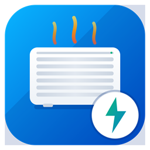

# Intuis Connect with Netatmo — Home Assistant

Intégration personnalisée Home Assistant pour le suivi énergétique et l'état de vos radiateurs électriques connectés équipés de modules **Intuis Connect with Netatmo** (ou **Muller Intuitiv with Netatmo** : marques Airelec, Applimo, Campa, Noirot).

Chaque pièce / radiateur est automatiquement créé comme un **Appareil Home Assistant** dédié avec ses capteurs d'énergie et de suivi, en plus d'un appareil global représentant le logement.

---

## Fonctionnalités

- ⚡ **Suivi énergétique complet** : Consommation électrique Aujourd'hui, Hier et Ce mois-ci pour chaque radiateur.
- 🕒 **Découpage Heures Pleines / Heures Creuses (HP/HC)** : Calcul automatique selon vos plages horaires personnalisables.
- 🌡️ **Température & Consigne** : Relevé de la température mesurée, de la consigne et de l'état de chauffe en temps réel (si supporté par votre installation).
- 🏠 **Totaux du logement** : Capteurs agrégés au niveau du domicile pour une vue d'ensemble instantanée.
- 📊 **Compatible Dashboard Énergie** : Capteurs en `state_class: total` et `device_class: energy` prêts à être intégrés dans le tableau de bord Énergie de Home Assistant.
- 🕛 **Rafraîchissement quotidien à 23h59** : En plus du rafraîchissement périodique configurable, une mise à jour s'exécute automatiquement chaque soir à 23h59 pour consolider l'intégralité de la consommation de la journée avant minuit.
- ⚙️ **Config Flow (100% UI)** : Configuration via l'interface avec email et mot de passe, détection automatique du bridge/passerelle et choix du logement si votre compte en possède plusieurs.

---

## Entités fournies

### Par Radiateur / Pièce

Chaque pièce découverte génère un appareil dédié (ex: *Radiateur Chambre*, *Radiateur Séjour*) :

| Entité | Unité | Description |
|---|---|---|
| `sensor.radiateur_<nom>_consommation_aujourd_hui` | Wh | Consommation cumulée depuis minuit (Total) |
| `sensor.radiateur_<nom>_consommation_aujourd_hui_hp` | Wh | Consommation aujourd'hui en Heures Pleines |
| `sensor.radiateur_<nom>_consommation_aujourd_hui_hc` | Wh | Consommation aujourd'hui en Heures Creuses |
| `sensor.radiateur_<nom>_consommation_hier` | Wh | Consommation totale de la journée d'hier |
| `sensor.radiateur_<nom>_consommation_hier_hp` | Wh | Consommation d'hier en Heures Pleines |
| `sensor.radiateur_<nom>_consommation_hier_hc` | Wh | Consommation d'hier en Heures Creuses |
| `sensor.radiateur_<nom>_consommation_ce_mois_ci` | kWh | Consommation cumulée du mois en cours |
| `sensor.radiateur_<nom>_temperature` | °C | Température mesurée dans la pièce (si disponible) |
| `sensor.radiateur_<nom>_consigne` | °C | Température de consigne actuelle (si disponible) |
| `sensor.radiateur_<nom>_puissance_de_chauffe` | % | Demande / puissance de chauffe active (si disponible) |

### Global (Logement)

Un appareil représentant le domicile regroupe la somme de tous les radiateurs :

| Entité | Unité | Description |
|---|---|---|
| `sensor.logement_<nom>_consommation_totale_aujourd_hui` | Wh | Somme totale consommée aujourd'hui |
| `sensor.logement_<nom>_consommation_totale_aujourd_hui_hp` | Wh | Somme consommée aujourd'hui en HP |
| `sensor.logement_<nom>_consommation_totale_aujourd_hui_hc` | Wh | Somme consommée aujourd'hui en HC |
| `sensor.logement_<nom>_consommation_totale_hier` | Wh | Somme totale consommée hier |
| `sensor.logement_<nom>_consommation_totale_ce_mois_ci` | kWh | Somme totale consommée ce mois-ci |

---

## Installation

### Via HACS (dépôt personnalisé)

Le bouton ouvre directement votre instance Home Assistant sur la boîte de dialogue HACS.

Sans le bouton, manuellement :
1. Ouvrez **HACS** → menu **⋮** en haut à droite → **Dépôts personnalisés**.
2. Renseignez l'URL : `https://github.com/maximeblanchard/ha-intuis`, catégorie **Intégration**.
3. Recherchez **Intuis Connect**, cliquez sur **Télécharger**, puis **redémarrez Home Assistant**.

### Manuelle

1. Téléchargez ou copiez le dossier `custom_components/intuis`.
2. Déposez-le dans le répertoire `config/custom_components/` de votre instance Home Assistant.
3. Redémarrez Home Assistant.

---

## Configuration

Paramètres → Appareils et services → Ajouter une intégration → **Intuis Connect**

1. Cliquez sur le bouton ci-dessus ou cherchez **Intuis Connect** dans la liste des intégrations.
2. Saisissez vos identifiants utilisés sur l'application mobile *Intuis Connect with Netatmo* (ou *Muller Intuitiv*).
3. Si votre compte gère plusieurs logements, sélectionnez celui que vous souhaitez intégrer.
4. Vos radiateurs et capteurs sont créés immédiatement !

### Options de l'intégration

En cliquant sur **Configurer** sur l'intégration :

| Option | Valeur par défaut | Description |
|---|---|---|
| **Intervalle de mise à jour** | `30` min | Fréquence d'interrogation de l'API (entre 10 et 360 min) |
| **Début Heures Pleines** | `6` (06:00) | Heure de début de la plage Heures Pleines |
| **Fin Heures Pleines** | `21` (21:59) | Heure de fin de la plage Heures Pleines (HC ensuite) |

---

## Intégration dans le Dashboard Énergie

Les capteurs de consommation mensuelle (`sensor.radiateur_<nom>_consommation_ce_mois_ci` ou `sensor.logement_<nom>_consommation_totale_ce_mois_ci`) ou journalière sont compatibles avec le tableau de bord Énergie de Home Assistant :

1. Allez dans **Paramètres** → **Tableaux de bord** → **Énergie**.
2. Dans la section **Consommation électrique** ou **Réseau individuel**, ajoutez les capteurs Intuis de votre choix.

---

## Auteur

Développé par [Maxime Blanchard](https://github.com/maximeblanchard).
Licence MIT.
